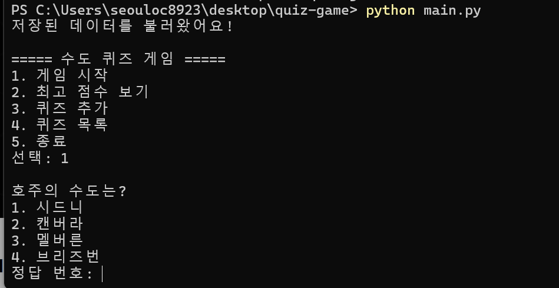
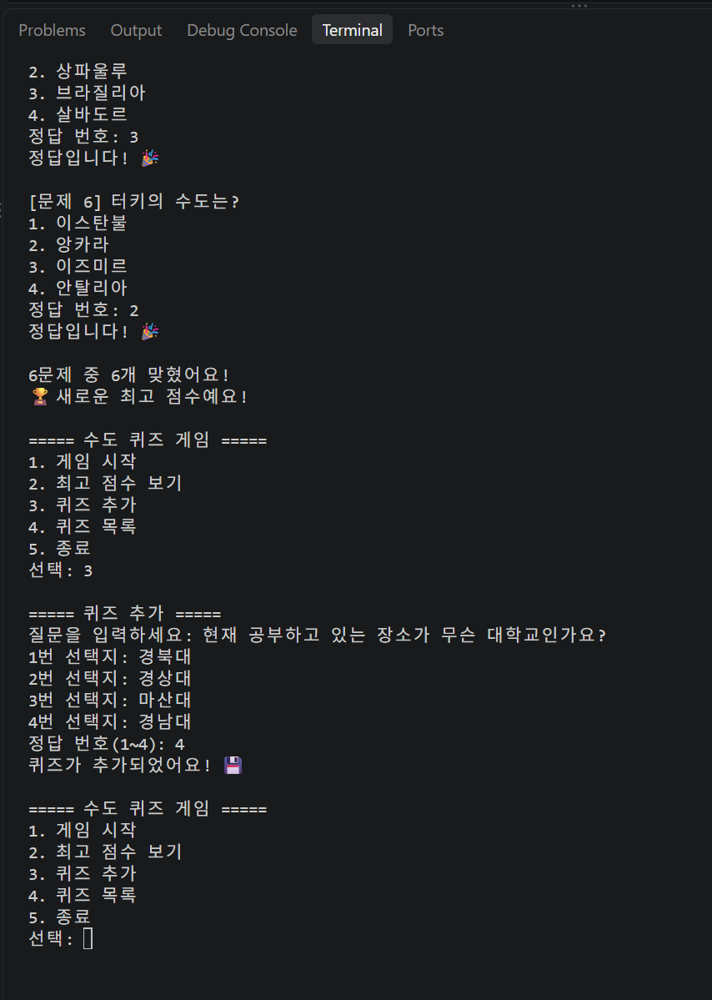
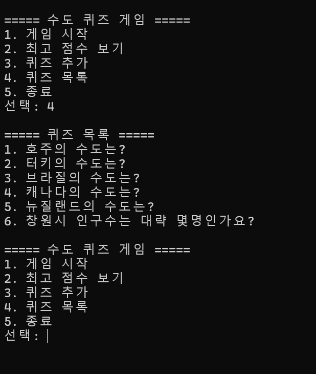
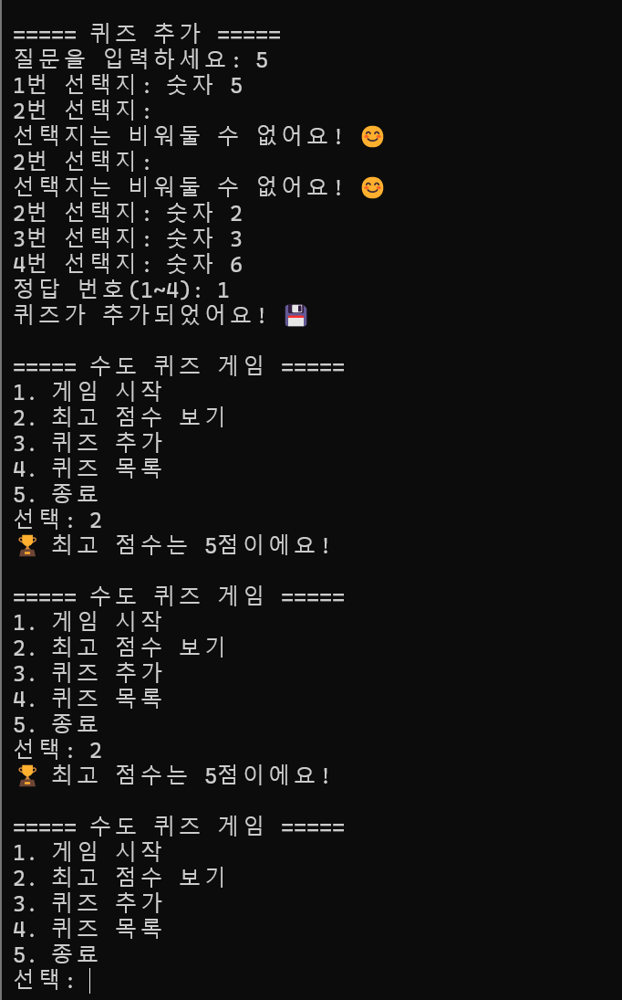
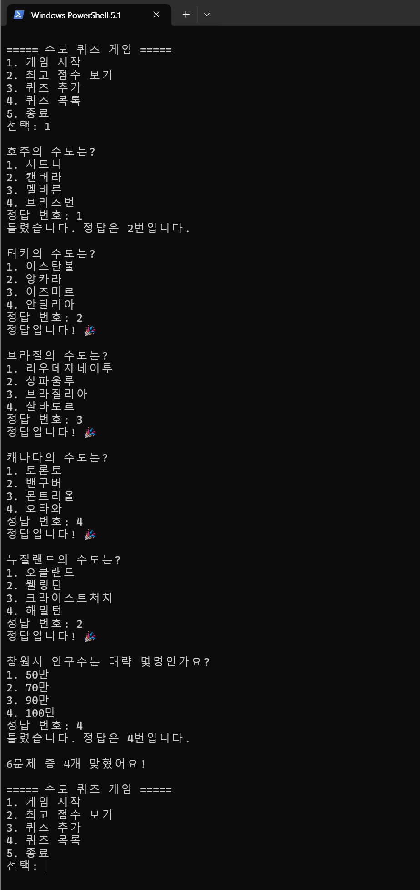
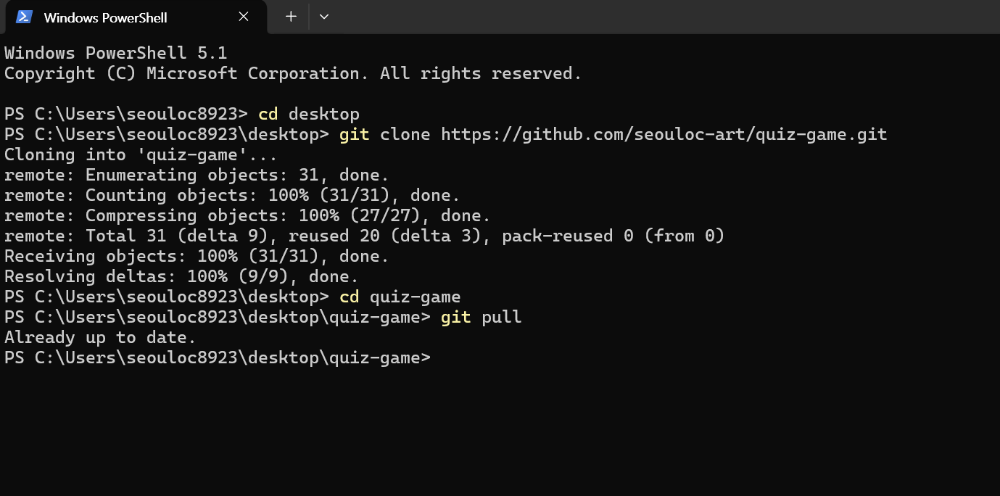
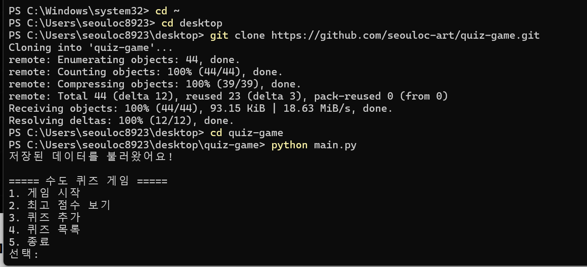
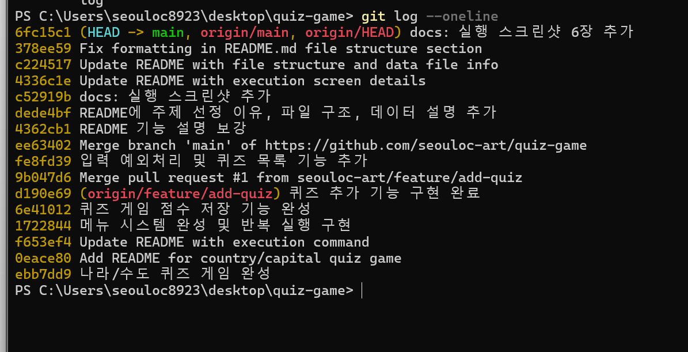
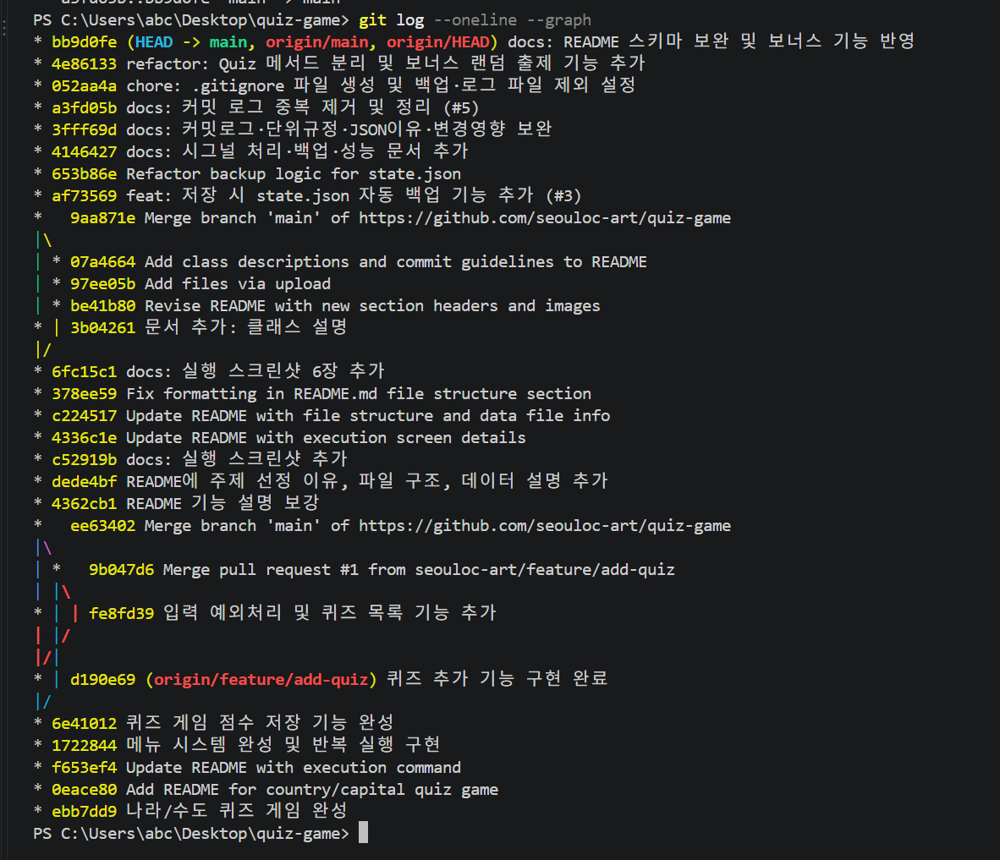

# 🌍 나라/수도 퀴즈 게임

파이썬으로 만든 터미널 기반 4지선다 나라/수도 맞히기 퀴즈 게임입니다.  
객체지향 구조(`Quiz`, `QuizGame`)와 JSON 파일 저장을 통해 프로그램을 종료해도 추가한 퀴즈와 최고 점수가 유지됩니다.

## ✨ 기능 목록
- **퀴즈 풀기 (보너스: 랜덤 출제)**: `random.sample()`을 활용해 매 게임마다 퀴즈 순서를 무작위로 섞어 출제
- **점수 계산 및 최고 점수 갱신**: 정답 입력 시 점수 계산, 최종 결과 출력 및 최고 점수 자동 갱신
- **퀴즈 추가**: 새로운 문제, 선택지 4개, 정답 번호 입력 및 즉시 저장
- **퀴즈 목록 보기**: 등록된 전체 퀴즈 목록 조회
- **입력 검증 및 예외 처리**: 빈 입력, 문자 입력, 범위 초과 입력 재입력 유도 및 `Ctrl+C`/`EOF` 안전 종료
- **데이터 영속성 및 자동 백업**: `state.json` 저장 전 `state.json.bak` 자동 백업, 파일 손상 시 기본 퀴즈 자동 복구

## 📋 메뉴 구성
1. 게임 시작
2. 최고 점수 보기
3. 퀴즈 추가
4. 퀴즈 목록
5. 종료

## ▶️ 실행 방법
Python 3.10 이상이 설치된 환경에서 프로젝트 루트 폴더로 이동해 아래 명령어를 실행하세요.

```bash
python main.py
```

## 💡 퀴즈 주제 선정 이유
평소 세계 여러 나라에 관심이 많았고, 나라와 수도는 누구나 한 번쯤 공부하는 친숙한 주제라 퀴즈로 만들기 적합하다고 생각해 선택했습니다.

## 📂 파일 구조

```text
quiz-game/
├── main.py          # 게임 실행 및 핵심 로직 (input_number, Quiz, QuizGame)
├── state.json       # 퀴즈 데이터와 최고 점수 저장 파일 (UTF-8)
├── .gitignore       # 캐시 및 백업 파일 제외 설정
├── README.md        # 프로젝트 설명 문서
└── images/          # 실행 화면 및 Git 증빙 스크린샷
```

## 💾 데이터 파일 설명 (`state.json`)
- **경로**: 프로젝트 루트 (`./state.json`)
- **역할**: 게임에서 추가한 퀴즈 목록과 최고 점수를 UTF-8 인코딩으로 저장합니다. 프로그램을 종료 후 다시 실행해도 데이터가 유지됩니다.
- **필드 구조 (스키마)**:
  - `best_score` (`int`): 지금까지 달성한 최고 정답 수
  - `quizzes` (`list[dict]`): 등록된 퀴즈 객체 리스트
    - `question` (`str`): 문제 내용
    - `choices` (`list[str]`): 보기 4개 리스트
    - `answer` (`int`): 정답 번호 (1~4)

```json
{
  "best_score": 5,
  "quizzes": [
    {
      "question": "호주의 수도는?",
      "choices": ["시드니", "캔버라", "멜버른", "브리즈번"],
      "answer": 2
    }
  ]
}
```

## 🎬 실행 화면

### 게임 실행


### 퀴즈 추가


### 퀴즈 목록


### 최고 점수 보기


### 게임 점수 결과


## 🧰 Git 작업 증빙

### clone / pull



### 커밋 로그


### 브랜치 / 병합 그래프


## 🏗️ 클래스 구조 및 역할 분리

### 📦 `Quiz` 클래스 — "문제 1개"를 담는 상자
- **속성**: `question`(문제), `choices`(보기 4개), `answer`(정답 번호)
- **메서드**:
  - `display(index)`: 문제와 1~4번 선택지 출력
  - `check_answer(user_answer)`: 사용자 입력과 정답 일치 여부 반환

### 📦 `QuizGame` 클래스 — "게임 전체"를 관리하는 상자
- **속성**: `quizzes`(퀴즈 목록), `score`(현재 점수), `best_score`(최고 점수), `played`(플레이 여부)
- **메서드**:
  - `play()`: 랜덤 출제 및 게임 진행
  - `add_quiz()`: 새 문제 추가
  - `show_quiz_list()`: 문제 목록 보기
  - `show_best_score()`: 최고 점수 보기
  - `save_state()` / `load_state()`: `state.json` 저장 / 불러오기 및 자동 백업·복구

### 🔀 역할 나누기 & 클래스를 쓴 이유
- `input_number()`: 숫자 입력 검증 전담
- `Quiz`: 개별 문제 데이터 및 출력·채점 전담
- `QuizGame`: 게임 흐름 및 파일 입출력 전담
- 역할을 분리해두면 문제를 여러 개 만들어도 재사용하기 쉽고, 특정 기능을 수정할 때 다른 코드에 미치는 영향을 줄일 수 있습니다.

## 💾 저장 흐름 & 백업·복원 (#17)
1. 프로그램 시작 → `load_state()`로 `state.json` 불러오기 (파일이 없거나 손상되면 기본 퀴즈로 복구)
2. 게임 종료 / 문제 추가 / 프로그램 종료 → `save_state()`로 저장
- **자동 백업**: `save_state()` 저장 직전에 기존 `state.json`을 `state.json.bak`으로 복사
- **수동 복원**: `copy state.json.bak state.json` (Windows) 또는 `cp state.json.bak state.json` (macOS/Linux)

## ⚙️ 종료·시그널 처리 (#11)
- `Ctrl+C`(`KeyboardInterrupt`)나 입력 스트림 종료(`EOFError`) 시에도 `save_state()`로 안전하게 저장 후 종료합니다.
- `SIGTERM` 강제 종료까지 대응하려면 `signal` 모듈을 활용할 수 있습니다 (Windows는 지원이 제한적이므로 기본은 `Ctrl+C` 처리를 사용).

```python
import signal

def _handle_sigterm(signum, frame):
    game.save_state()
    raise SystemExit(0)

signal.signal(signal.SIGTERM, _handle_sigterm)
```

## 💡 JSON을 선택한 이유 (#14)
- **가독성**: 사람이 파일을 열어봐도 구조를 바로 이해할 수 있습니다.
- **구조화**: 중첩 구조(퀴즈 목록, 선택지 리스트, 최고 점수)를 자연스럽게 표현합니다.
- **파이썬 친화적**: 표준 라이브러리 `json` 모듈만으로 `dict ↔ 파일` 변환이 가능합니다.
- **별도 DB 불필요**: 소규모 데이터라 파일 하나로 가볍게 관리할 수 있습니다.

## 📊 대량 데이터 성능 고려 (#16)
- 퀴즈가 1,000개 이상으로 늘어나면 매번 JSON 전체를 읽고 쓰므로 I/O와 메모리 사용량이 선형(O(n))으로 증가합니다.
- **개선 방안**: 목록 페이징(20개씩 출력), 딕셔너리 인덱스 도입, 대용량 확장 시 SQLite 전환 검토.

## 📈 변경 영향도 (#18)

| 변경 요구 | 수정할 메서드 / 위치 |
| :--- | :--- |
| 점수 계산 방식 변경 | `QuizGame.play()` 내 점수 증가 부분 |
| 퀴즈 데이터 구조 변경 | `Quiz.__init__`, `save_state()`, `load_state()` |
| 저장 방식 변경 (JSON → DB) | `save_state()`, `load_state()` |
| 기본 퀴즈 변경 | `setup_quizzes()` |

## 📌 커밋 규칙 & 로그 (#5)

**커밋 단위 규정**: 한 기능/버그당 1커밋(작게 자주 커밋), `<타입>: <요약>` 형식 사용

| 타입 | 의미 | 예시 |
| :--- | :--- | :--- |
| `feat` | 새 기능 | `feat: 퀴즈 랜덤 출제 기능 추가` |
| `fix` | 버그 수정 | `fix: state.json 정답 타입 오류 수정` |
| `refactor` | 코드 구조 개선 | `refactor: Quiz 클래스 메서드 분리` |
| `docs` | 문서 수정 | `docs: README 스키마 및 실행 방법 보완` |

> 전체 커밋 이력은 `git log --oneline --graph`로 확인할 수 있습니다.