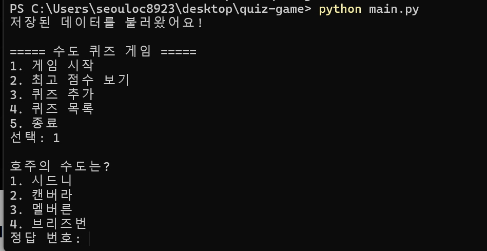
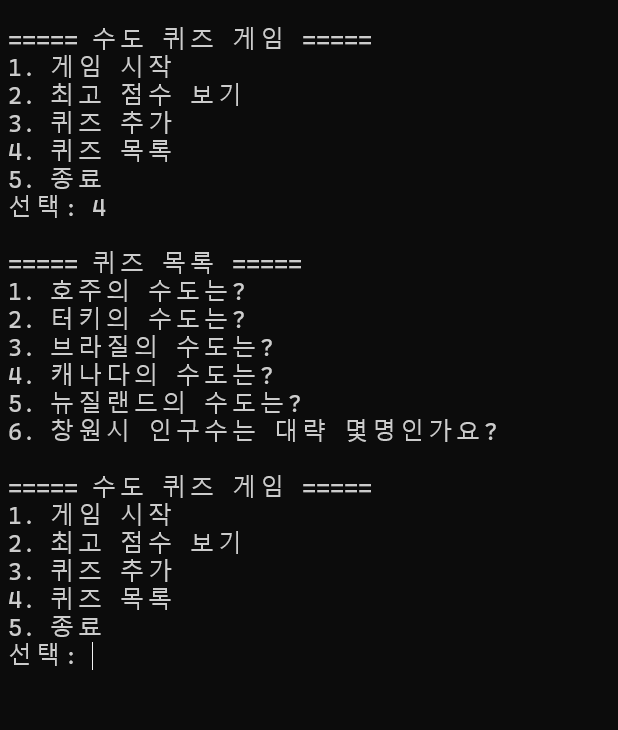
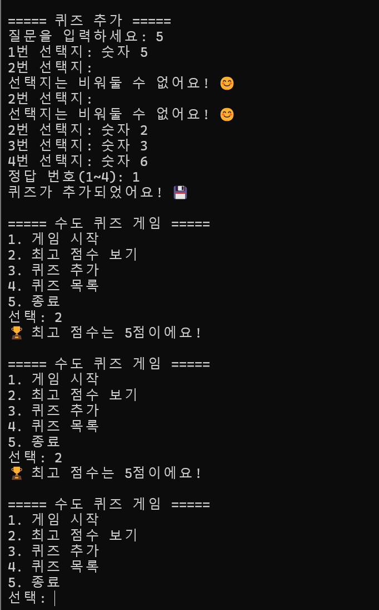
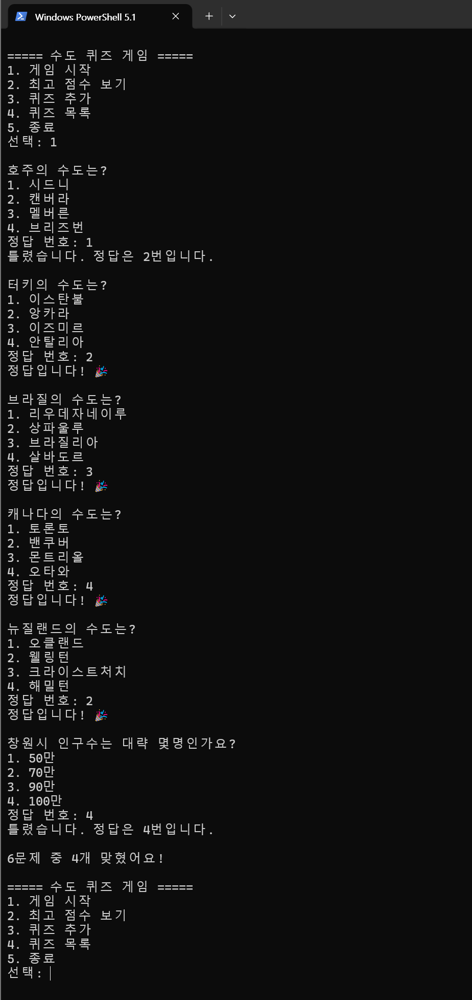
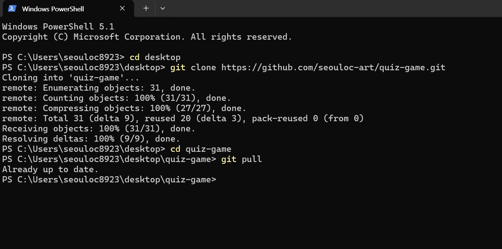
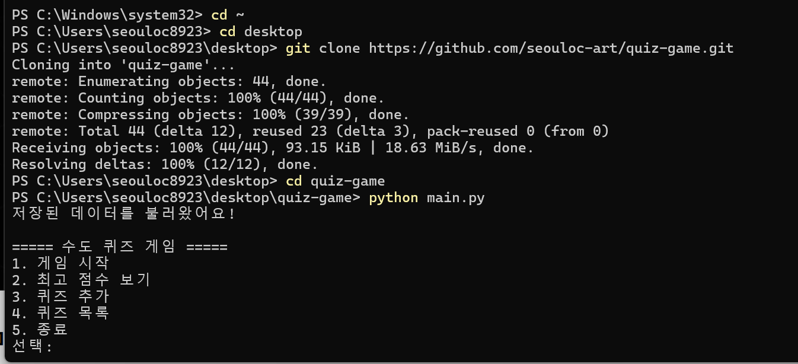
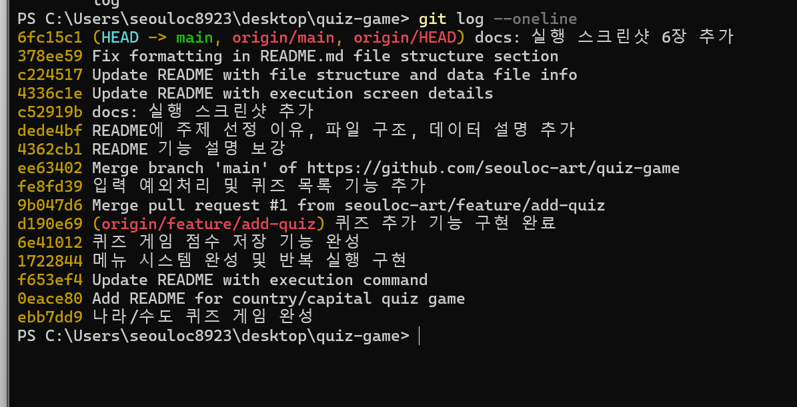
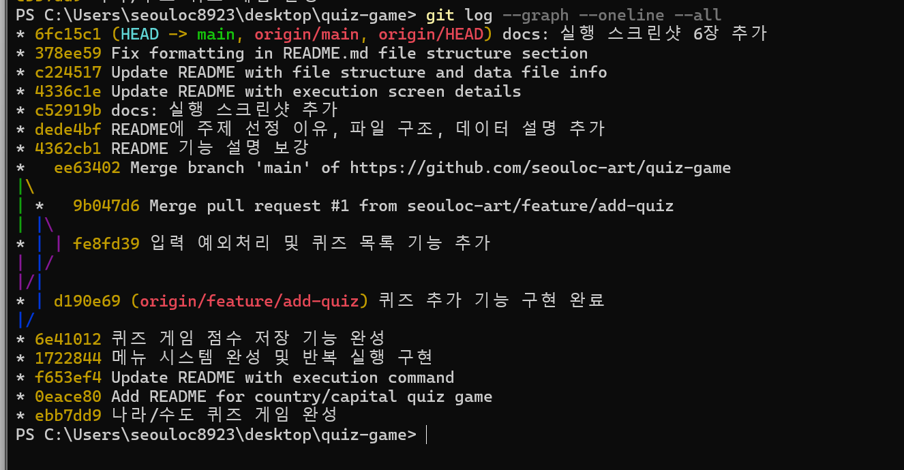

# 🌍 나라/수도 퀴즈 게임

파이썬으로 만든 간단한 수도 맞히기 퀴즈 게임입니다!

## ✨ 기능
- 4지선다 나라/수도 퀴즈 출제
- 정답 입력 시 점수 계산 및 최종 결과 출력
- 최고 점수 자동 저장 및 갱신
- 새로운 퀴즈 추가하기
- 등록된 퀴즈 목록 보기
- JSON 파일로 데이터 저장 / 불러오기

## 📋 메뉴 구성
1. 게임 시작
2. 최고 점수 보기
3. 퀴즈 추가
4. 퀴즈 목록
5. 종료

## ▶️ 실행 방법
파이썬이 설치된 환경에서 아래 명령어를 실행하세요.

​```
python main.py
​```

## 💡 퀴즈 주제 선정 이유
평소 세계 여러 나라에 관심이 많았고, 나라와 수도는
누구나 한 번쯤 공부하는 친숙한 주제라 퀴즈로 만들기
적합하다고 생각해 선택했습니다.

## 📂 파일 구조

```
quiz-game/
├── main.py       # 게임 실행 및 핵심 로직 (Quiz, QuizGame 클래스)
├── README.md     # 프로젝트 설명 문서
└── state.json    # 퀴즈 데이터와 최고 점수 저장 파일
```

## 💾 데이터 파일 설명 (state.json)
- 게임에서 추가한 퀴즈와 최고 점수를 저장하는 파일입니다.
- UTF-8 인코딩으로 저장되어 한글이 깨지지 않습니다.
- 프로그램을 종료 후 다시 실행해도 데이터가 유지됩니다.

## 🎬 실행 화면

### 게임 실행


### 퀴즈 목록


### 최고 점수 보기


### 게임 점수 결과


## 🧰 Git 작업 증빙

### clone / pull



### 커밋 로그


### 브랜치 / 병합 그래프


## 🏗️ 클래스(상자) 설명

### 📦 Quiz 클래스 — "문제 1개"를 담는 상자
- question : 문제 내용
- choices : 보기 4개
- answer : 정답 번호
→ 문제 하나의 정보를 한곳에 모아둡니다.

### 📦 QuizGame 클래스 — "게임 전체"를 움직이는 상자
- play() : 게임 진행
- add_quiz() : 문제 추가
- show_quiz_list() : 문제 목록 보기
- show_best_score() : 최고 점수 보기
- save_state() / load_state() : 저장 / 불러오기
→ 게임의 모든 기능을 담당합니다.

## 🔀 역할 나누기
- input_number() : 숫자 입력이 맞는지 검사 (입력 검증)
- QuizGame : 게임 진행
- Quiz + state.json : 데이터 저장
→ 각자 맡은 일이 달라서 수정하기 편해요!

## 💾 저장 흐름
1. 프로그램 시작 → load_state() 로 불러오기
2. 게임 끝 / 문제 추가 / 종료 → save_state() 로 저장
→ 껐다 켜도 점수와 문제가 그대로 남아요!

## 📌 커밋 규칙
- "기능 추가: 퀴즈 저장 기능" 처럼
  [무엇을 했는지] 를 짧게 적습니다.
  
  **커밋 단위 규정:**
- **한 기능/버그당 1커밋** (작게 자주 커밋)
- 여러 변경을 한 번에 몰아서 커밋하지 않음

**메시지 템플릿:** `<타입>: <요약>`
| 타입 | 의미 | 예시 |
|------|------|------|
| feat | 새 기능 | feat: 자동 백업 추가 |
| fix | 버그 수정 | fix: 들여쓰기 오류 수정 |
| docs | 문서 수정 | docs: README 보완 |

## 💡 클래스를 쓴 이유
- 문제 정보를 Quiz 상자에 깔끔하게 모을 수 있어요.
- 문제를 여러 개 만들어도 똑같이 쓸 수 있어요. (재사용!)

## 📊 변경 영향도
- Quiz 를 고치면 → 문제 저장/불러오기에 영향
- QuizGame 을 고치면 → 게임 진행에 영향

## ⚙️ 종료·시그널 처리 (#11)

- Ctrl+C(KeyboardInterrupt)나 EOF 입력 시에도 save_state()로 안전하게 저장돼요.
- SIGTERM 같은 강제 종료까지 저장하려면 signal 모듈을 쓸 수 있어요 (예시):

```python
import signal
def _handle_sigterm(signum, frame):
    game.save_state()
    raise SystemExit(0)
signal.signal(signal.SIGTERM, _handle_sigterm)
```
> Windows는 SIGTERM 지원이 제한적이라, 기본은 Ctrl+C 처리를 사용해요.

## 💾 백업·복원 (#17)

- **자동 백업:** save_state() 저장 전에 기존 state.json을 state.json.bak으로 복사해요.
- **자동 복구:** 파일이 깨지면 load_state()가 기본 퀴즈로 복원해요.
- **수동 복원:** `copy state.json.bak state.json` (Windows) 로 되돌려요.

## 📊 대량 데이터 성능 (#16)

- 퀴즈 1000개 이상이면 JSON 전체를 읽고 쓰므로 I/O·메모리가 선형 증가해요.
- 목록 검색은 리스트라서 O(n)이에요.
- **개선 방안:** 목록 페이징(20개씩), 딕셔너리 인덱스, 대용량 시 SQLite 전환 검토.

## 📜 커밋 로그 (#5)

총 24개의 의미있는 커밋으로 작업했습니다.

```
3fff69d docs: 커밋로그·단위규정·JSON이유·변경영향 보완
4146427 docs: 시그널 처리·백업·성능 문서 추가
653b86e Refactor backup logic for state.json
af73569 feat: 저장 시 state.json 자동 백업 기능 추가 (#3)
9aa871e Merge branch 'main' of https://github.com/seouloc-art/quiz-game
3b04261 문서 추가: 클래스 설명
07a4664 Add class descriptions and commit guidelines to README
97ee05b Add files via upload
be41b80 Revise README with new section headers and images
6fc15c1 docs: 실행 스크린샷 6장 추가
378ee59 Fix formatting in README.md file structure section
c224517 Update README with file structure and data file info
4336c1e Update README with execution screen details
c52919b docs: 실행 스크린샷 추가
dede4bf README에 주제 선정 이유, 파일 구조, 데이터 설명 추가
4362cb1 README 기능 설명 보강
ee63402 Merge branch 'main' of https://github.com/seouloc-art/quiz-game
fe8fd39 입력 예외처리 및 퀴즈 목록 기능 추가
9b047d6 Merge pull request #1 from seouloc-art/feature/add-quiz
d190e69 퀴즈 추가 기능 구현 완료
6e41012 퀴즈 게임 점수 저장 기능 완성
1722844 메뉴 시스템 완성 및 반복 실행 구현
f653ef4 Update README with execution command
0eace80 Add README for country/capital quiz game
ebb7dd9 나라/수도 퀴즈 게임 완성
```

## 💡 JSON을 선택한 이유 (#14)

- **가독성:** 사람이 열어봐도 내용을 바로 이해할 수 있어요.
- **구조화:** 중첩 구조(퀴즈 목록, 점수)를 자연스럽게 표현해요.
- **파이썬 친화:** json 모듈로 dict ↔ 파일 변환이 간단해요.
- **별도 DB 불필요:** 소규모 데이터라 파일 하나로 충분해요.

## 📈 변경 영향도 (#18)

요구 변경 시 수정해야 할 **구체적 대상:**

| 변경 요구 | 수정할 메서드/위치 |
|----------|------------------|
| 점수 계산 방식 변경 | `QuizGame.play()` 내 점수 증가 부분 |
| 퀴즈 데이터 구조 변경 | `Quiz.__init__`, `save_state()`, `load_state()` |
| 저장 방식 변경(JSON→DB) | `save_state()`, `load_state()` |
| 기본 퀴즈 변경 | `setup_quizzes()` |

